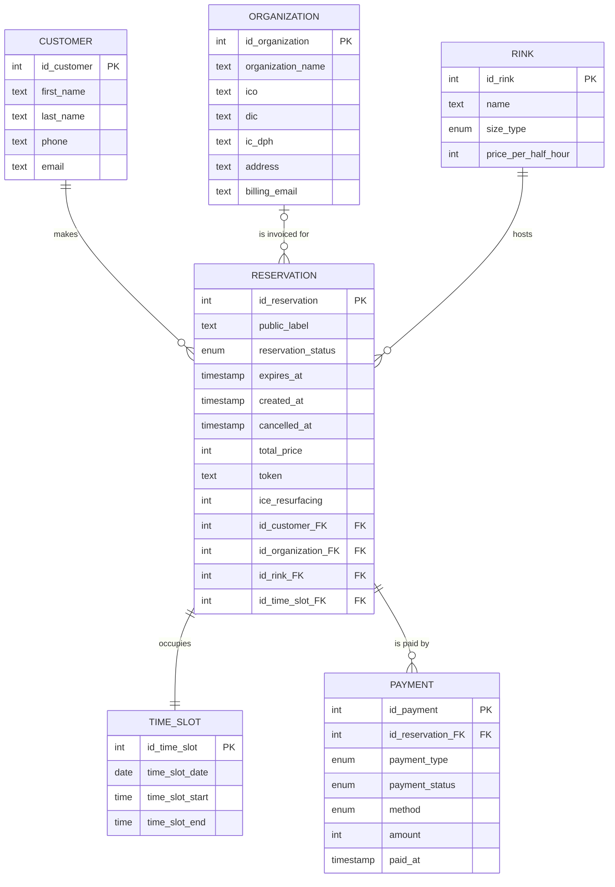

# Data model

This document describes the entities, their fields and the relationships
between them for a winter stadium with two ice rinks (one main and one
smaller). It was written before any reservation code, so that everyone
agrees on what is stored before stage 2 (reservations and preventing
double booking) starts.

## Assumptions (business rules)

The stadium is fictional, so these rules are our own assumptions and not
taken from a real stadium.

- One time slot belongs to exactly one reservation. Two reservations cannot
  share the same time slot on the same rink.
- A customer or an organization can reserve a rink for a minimum of
  30 minutes. Longer reservations grow in steps of 30 minutes
  (60, 90, 120, 180 minutes, ...).
- A reservation can start every 15 minutes (:00, :15, :30, :45).
- After every reservation the rink is blocked for 15 minutes for ice
  resurfacing. The next reservation can start only after this time.
- The price is 50 € per 30 minutes for the main rink and 30 € per
  30 minutes for the small rink.
- The deposit is 30 % of the total price.
- With these prices and a 30 % deposit, the deposit is always a whole number
  of euros. If the deposit is not a whole number of euros, it is rounded up
  to the next whole euro.
- The deposit is not refunded when a reservation is cancelled.
- The customer pays either the deposit or the full amount when
  reserving, and the remainder can be paid at the stadium or online later.
- A reservation goes through these states: `pending_payment`, `confirmed`,
  `cancelled` and `expired`.
- A new reservation starts as `pending_payment`. The time slot is held for
  15 minutes (`expires_at`).
- When the deposit or the full amount is paid, the reservation becomes
  `confirmed`.
- If nothing is paid before `expires_at`, the reservation becomes `expired`
  and the time slot is free again.
- A `confirmed` reservation can become `cancelled`. An `expired` or
  `cancelled` reservation never becomes `confirmed` again. A new reservation
  must be created.
- Every payment is stored as a separate row in `payment` with a type:
  `deposit`, `remainder` or `full`.
- The remaining amount is calculated as `total_price` minus the sum of all
  paid payments. The reservation is fully paid when the remaining amount is 0.

## Out of scope

- Invoices (the `invoice` entity, numbering, VAT calculation).
- Matches and public skating (blocking the schedule without a customer).
- Recurring reservations (e.g. a club every Tuesday).
- Refunds and cancellation policy beyond "deposit is not refunded".

## Entities

### PAYMENT

| Field | Type | Null | Description |
|---|---|---|---|
| id_payment (PK) | int | no | Unique identifier of the payment |
| id_reservation_FK | int | no | Reservation this payment belongs to |
| payment_type | enum | no | deposit / remainder / full |
| payment_status | enum | no | pending / paid / failed |
| method | enum | no | online / cash / card_on_site |
| amount | int | no | Amount of this payment in whole euros |
| paid_at | timestamp | yes | When the payment was made; empty until paid |

### RESERVATION

| Field | Type | Null | Description |
|---|---|---|---|
| id_reservation (PK) | int | no | Unique identifier of the reservation |
| public_label | text | no | Text shown to everyone on the public schedule (e.g. club name) |
| reservation_status | enum | no | pending_payment / confirmed / cancelled / expired |
| expires_at | timestamp | yes | Deadline of the temporary hold (created_at + 15 min); empty once confirmed |
| created_at | timestamp | no | When the reservation was created |
| cancelled_at | timestamp | yes | When the reservation was cancelled; empty if not cancelled |
| total_price | int | no | Total price of the reservation in whole euros |
| token | text | no | Unique random code encoded in the QR/bar code, used by the cashier |
| ice_resurfacing | int | no | Minutes reserved after the booking for ice resurfacing |
| id_customer_FK | int | no | Person who made the reservation |
| id_organization_FK | int | yes | Club or company, only if invoicing an organization |
| id_rink_FK | int | no | Rink being reserved |
| id_time_slot_FK | int | no | Booked date and time |

### CUSTOMER

| Field | Type | Null | Description |
|---|---|---|---|
| id_customer (PK) | int | no | Unique identifier of the customer |
| first_name | text | no | First name of the person who reserves |
| last_name | text | no | Last name of the person who reserves |
| phone | text | no | Contact phone number, including country code |
| email | text | no | Contact email address |

### ORGANIZATION

| Field | Type | Null | Description |
|---|---|---|---|
| id_organization (PK) | int | no | Unique identifier of the organization |
| organization_name | text | no | Official name used on invoices |
| ico | text | no | Company registration number |
| dic | text | yes | Tax identification number |
| ic_dph | text | yes | VAT identification number, only for VAT payers |
| address | text | no | Registered address of the organization |
| billing_email | text | no | Email where invoices are sent |

### RINK

| Field | Type | Null | Description |
|---|---|---|---|
| id_rink (PK) | int | no | Unique identifier of the rink |
| name | text | no | Display name of the rink |
| size_type | enum | no | main / small |
| price_per_half_hour | int | no | Price in whole euros for 30 minutes on this rink |

### TIME_SLOT

| Field | Type | Null | Description |
|---|---|---|---|
| id_time_slot (PK) | int | no | Unique identifier of the time slot |
| time_slot_date | date | no | Day of the booking |
| time_slot_start | time | no | Start time |
| time_slot_end | time | no | End time (ice resurfacing time is not included) |

## Relationships

- RESERVATION 1:N PAYMENT
- CUSTOMER 1:N RESERVATION
- ORGANIZATION 1:N RESERVATION
- RINK 1:N RESERVATION
- RESERVATION 1:1 TIME_SLOT

An organization is optional: a reservation of a private person has no organization.

## ER diagram

